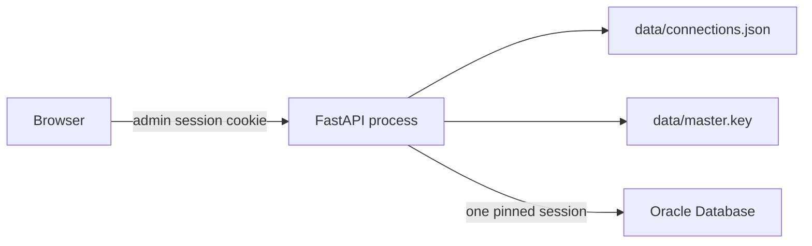

# Architecture

E1P DB Viewer is one Python process. The browser talks to FastAPI. FastAPI holds at most one Oracle session per signed-in browser and talks to Oracle with `python-oracledb` in thin mode.

## Layout

| Path | Role |
| --- | --- |
| `app/main.py` | Process setup, security headers, session cookie, `/healthz` |
| `app/web.py` | Sign-in page and the worksheet page |
| `app/api.py` | JSON API |
| `app/store.py` | Saved connection profiles |
| `app/library.py` | Named buckets of worksheet SQL in `data/query-library.json` |
| `app/secretsbox.py` | Fernet encrypt and decrypt |
| `app/db.py` | Driver connections and the pinned-session registry |
| `app/jdbc.py` | JDBC URL and Oracle Net connect-string parser |
| `app/sqlsplit.py` | Worksheet script splitter |
| `app/worksheet.py` | Execute SQL and PL/SQL, binds, `DBMS_OUTPUT`, and paged query cursors |
| `app/catalog.py` | Schema browser |
| `app/monitor.py` | Session and tablespace dashboards, including fallback |
| `app/static` | CSS and JavaScript. No front-end build step |
| `scripts/` | Install, start, stop, status, systemd install, and `scripts/gce.sh` for Compute Engine |
| `deploy/` | systemd unit and an nginx example |

Pages are Jinja templates. The worksheet is a textarea and `fetch`. There is no Node build, so a Red Hat host only needs Python. Appearance is a `data-theme` attribute on the page (`dark`, `light`, `midnight`, `harbor`, `sand`, or `contrast`), saved in the browser as `e1p-theme`. The server does not store the theme.

A paged `SELECT` keeps its Oracle cursor on the working connection. **Next** calls `fetchmany` for one more page. The cursor is closed when the result ends, when the worksheet runs again, or when that connection closes. Earlier pages stay in the browser only. The query library is one JSON file for the server operator.

## Request path

1. `scripts/start.sh`, systemd, or `scripts/gce.sh deploy` runs `python -m app`. The Compute Engine path installs under `/opt/e1p-db-viewer` as user `e1p` and keeps the listener on `127.0.0.1`. The laptop reaches it with `scripts/gce.sh tunnel`. The admin password is prompted on the laptop, written once to a mode `0600` file on the VM, hashed, and the file is removed.
2. The process reads `.env` with a parser that does not expand `$`. Argon2 hashes contain dollar signs.
3. The operator signs in. The admin password is checked with argon2. Failures are counted per client address and then rejected for a window.
4. The session cookie is signed, `HttpOnly`, and `SameSite=Lax`. `COOKIE_SECURE` turns on the Secure flag. A new CSRF token is issued at sign-in. POST, PUT, and DELETE must send it in `X-CSRF-Token`.
5. Saving a connection encrypts the database password and the wallet password with a Fernet key in `data/master.key`. The API never returns those secrets.
6. Connect opens an Oracle connection and keeps it. Opening a second saved connection does not close the first. One of the open connections is the working connection. The worksheet, object browser, sessions, tablespaces, and runtime dashboard all use it. Choosing another open connection makes that one working and leaves the rest open. Commit and rollback apply to the working connection.
7. Disconnect closes one open connection and rolls it back. It does not commit. If that connection was working, another open connection becomes working. Idle timeout and process shutdown roll every open connection back and close it.

Workers stay at 1. A second process would not see the pinned session.

`DB_CALL_TIMEOUT_MS` is applied as `call_timeout` on the Oracle connection.

## Dashboards

`app/monitor.py` tries the instance views first.

- Sessions: `V$SESSION` joined to `V$SQL` for the current and previous statement text, then `V$SESSION` alone if `V$SQL` is not granted, then a shorter column list if Oracle reports `ORA-00904`, then `SYS_CONTEXT` for the current session only. Kill uses `ALTER SYSTEM KILL SESSION` with the SID and serial taken as integers. Grids filter and sort in the browser on the rows already fetched.
- Tablespaces: `DBA_*` permanent and temporary files, then `USER_TABLESPACES`, `USER_SEGMENTS`, and `USER_FREE_SPACE`.
- Runtime: each block (`V$INSTANCE`, `V$SGA`, `V$PGASTAT`, `V$SYSMETRIC`, long-running `V$SESSION`, `V$SESSION_LONGOPS`, `V$SQL`) fails on its own and keeps the Oracle error plus the grant that would open that block.

The JSON response includes `source` and `notice`. `notice` contains the Oracle error text and the grant that would show the instance-wide data. The page renders that banner. A missing grant is not hidden.

Schema SQL that interpolates an object name uses an allow-list (`^[A-Za-z][A-Za-z0-9_$#]{0,127}$`) and double quotes. Filters and bind values are bound parameters.

## Security controls

- Admin password hash only. The database password is encrypted at rest and redacted if it ever appears in a driver error string.
- Login throttling. Default 8 failures in 10 minutes.
- CSRF on state-changing requests. Content-Security-Policy does not allow inline scripts.
- API schema endpoints (`/docs`, OpenAPI) are off.
- Wallet paths must be absolute directories that contain `tnsnames.ora` and a wallet file. When `WALLET_ROOT` is set, the resolved path must stay inside it, including after symlink resolution.
- Optional per-connection read-only mode rejects anything that is not `SELECT` or `WITH` before it is sent.
- Audit log `data/audit.log` records sign-in, connect, and statement counts. SQL text is omitted unless `AUDIT_SQL_TEXT=true`. A full disk does not block the worksheet; the failure is logged and the request continues.
- Default bind is `127.0.0.1`. `FORWARDED_ALLOW_IPS` defaults to loopback so a remote client cannot spoof proxy headers.
- The systemd unit refuses to be installed as root. It sets `NoNewPrivileges` and `PrivateTmp`. It does not turn on a full filesystem lockdown, because wallet files usually live outside the install directory. Run as a dedicated user instead.

Anyone who can sign in can run SQL as the saved database users. Treat the admin password, `.env`, and `data/master.key` as secrets.

## Files on disk

| File | Mode target | Contents |
| --- | --- | --- |
| `.env` | `0600` | Bind address, session secret, admin hash. No database passwords |
| `data/master.key` | `0600` | Fernet key |
| `data/connections.json` | `0600` | Connection profiles and ciphertext |
| `data/audit.log` | `0600` | Operator events |
| `data/server.log` | created by `start.sh` | Process log when not using systemd |
| wallet directory | `0700` | Unzipped Autonomous wallet, outside the git tree |

Back up `.env`, `data/master.key`, and `data/connections.json` together.
